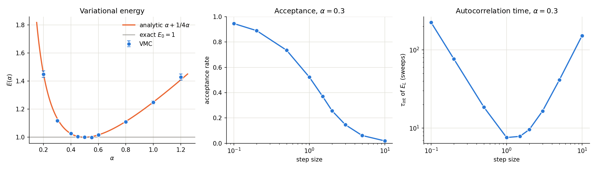
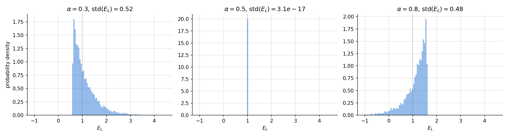

# Stage 0 — single-particle VMC

The code is in `code/stage0.py`, adapted from `Countinuos/VMC.ipynb`. Run it with `python stage0.py`
(about 25 s). The tests are in `code/tests/test_stage0.py` and run with `python -m pytest tests -q`.

## Trial state and local energy

For $\Psi_\alpha=\mathcal N_\alpha e^{-\alpha r^2}$ in $d$ dimensions,
$\int d^dr\,e^{-2\alpha r^2}=(\pi/2\alpha)^{d/2}$, so $\mathcal N_\alpha=(2\alpha/\pi)^{d/4}$, finite only for $\alpha>0$.
From $\nabla^2e^{-\alpha r^2}=(-2\alpha d+4\alpha^2r^2)\,e^{-\alpha r^2}$:

$$E_L=d\alpha+\left(\tfrac12-2\alpha^2\right)r^2,\qquad
\langle r^2\rangle=\frac d{4\alpha},\qquad
E(\alpha)=\frac d2\left(\alpha+\frac1{4\alpha}\right),$$

which is minimal at $\alpha_\star=\frac12$, where $E_0=d/2=1$ for $d=2$.

## Why the exact state has zero local-energy variance

If $\Psi$ is an eigenstate, $H\Psi=E_0\Psi$, then $E_L(\mathbf r)=H\Psi/\Psi=E_0$ at every position, not
only on average. Every Monte Carlo sample returns the same number, so $\mathrm{Var}[E_L]=0$ and the
error bar vanishes for any number of samples. Here this is visible directly: at $\alpha=\frac12$ the
coefficient of $r^2$ in $E_L$ is zero. The run gives $\mathrm{Var}[E_L]=10^{-33}$, which is rounding
error. Away from $\alpha=\frac12$ the variance grows again, so it measures how far $\Psi$ is from an
eigenstate. At $\alpha=\frac12$ the local energy is constant whatever is sampled, so this checks the
derivatives, not the sampler. The sampler is checked by $\langle r^2\rangle$ and by $E(\alpha)$ away from
the optimum.

## Results (20 000 samples per point, step 1.0, 1000 burn-in sweeps)

| $\alpha$ | $E$ (VMC) | $E$ (exact) | Var $E_L$ | acceptance | $\tau_{\rm int}$ | ESS |
| --- | --- | --- | --- | --- | --- | --- |
| 0.20 | 1.4490 ± 0.0228 | 1.4500 | 1.07 | 0.59 | 8.4 | 2375 |
| 0.30 | 1.1184 ± 0.0103 | 1.1333 | 0.27 | 0.51 | 9.1 | 2204 |
| 0.40 | 1.0267 ± 0.0036 | 1.0250 | 0.049 | 0.46 | 7.3 | 2736 |
| 0.45 | 1.0047 ± 0.0019 | 1.0056 | 0.011 | 0.44 | 7.5 | 2680 |
| **0.50** | **1.0000 ± 0.0000** | **1.0000** | **1e-33** | 0.43 | – | – |
| 0.55 | 0.9995 ± 0.0015 | 1.0045 | 0.010 | 0.41 | 7.5 | 2659 |
| 0.60 | 1.0161 ± 0.0033 | 1.0167 | 0.033 | 0.38 | 7.6 | 2639 |
| 0.80 | 1.1090 ± 0.0099 | 1.1125 | 0.23 | 0.34 | 8.8 | 2273 |
| 1.00 | 1.2480 ± 0.0136 | 1.2500 | 0.59 | 0.29 | 10.0 | 2006 |
| 1.20 | 1.4283 ± 0.0228 | 1.4083 | 0.93 | 0.26 | 10.5 | 1896 |

- **$E(\alpha)$ agrees with the analytic curve.** All points are within $1.5\sigma$, except
  $\alpha=0.55$, which is $3.4\sigma$ low. A longer check (4 × 250 000 sweeps) gives
  $\langle r^2\rangle=0.9086\pm0.0021$ against the exact $0.9091$, so the sampler is unbiased and that
  point is a statistical fluctuation.
- **The error bars scale as $1/\sqrt{M_{\rm eff}}$.** The blocking error matches
  $\mathrm{std}(E_L)/\sqrt{\rm ESS}$. For example, at $\alpha=0.3$ it is $0.0103$ against
  $0.52/\sqrt{2204}=0.0111$. The naive $\mathrm{std}/\sqrt{M}$ would be too small by
  $\sqrt{\tau}\approx3$.
- **Step size ($\alpha=0.3$).** The acceptance falls steadily with the step: 0.95 at step 0.1, 0.02 at
  step 10. The autocorrelation time is lowest, $\tau\approx8$, for steps 1.0–1.5 (acceptance 0.5–0.4).
  It is large at both ends: $\tau=224$ at step 0.1 and $152$ at step 10. A high acceptance does not mean
  good sampling, so the step is chosen from the ESS.
- **Optimization.** After the scan, gradient descent ($dE/d\alpha=2\,\mathrm{Cov}(E_L,-r^2)$,
  starting from $\alpha=0.2$) converges to $\alpha=0.5000000000$. A final run with $\alpha$ fixed gives
  $E=1.0000000000\pm1.5\times10^{-14}$: the relative error is far below $10^{-3}$.

The histograms show broad distributions away from the optimum: $E_L\ge0.6$ for $\alpha=0.3$ and
$E_L\le1.6$ for $\alpha=0.8$, where many single values are below $E_0$ and only the average is bounded.
At $\alpha=\frac12$ all samples fall in a single spike at $E_L=1$.
